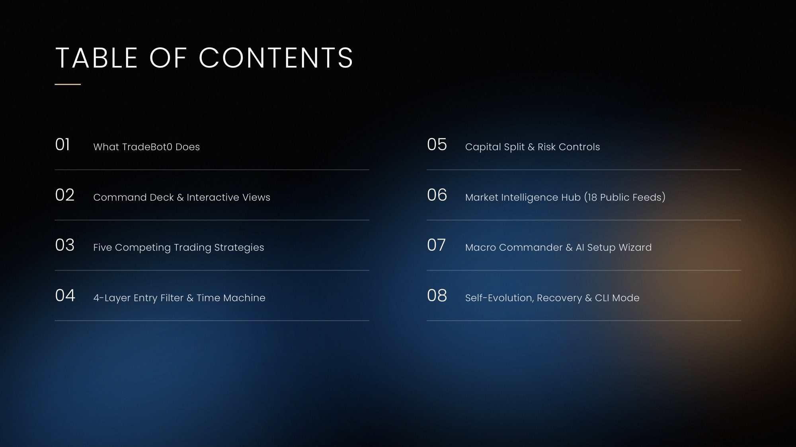
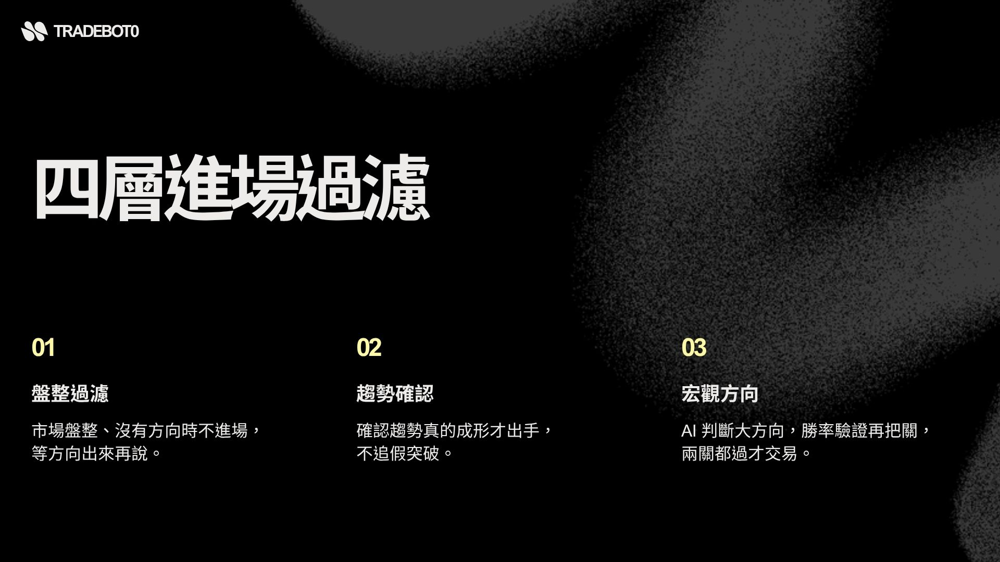
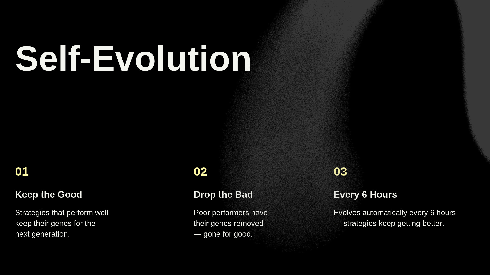
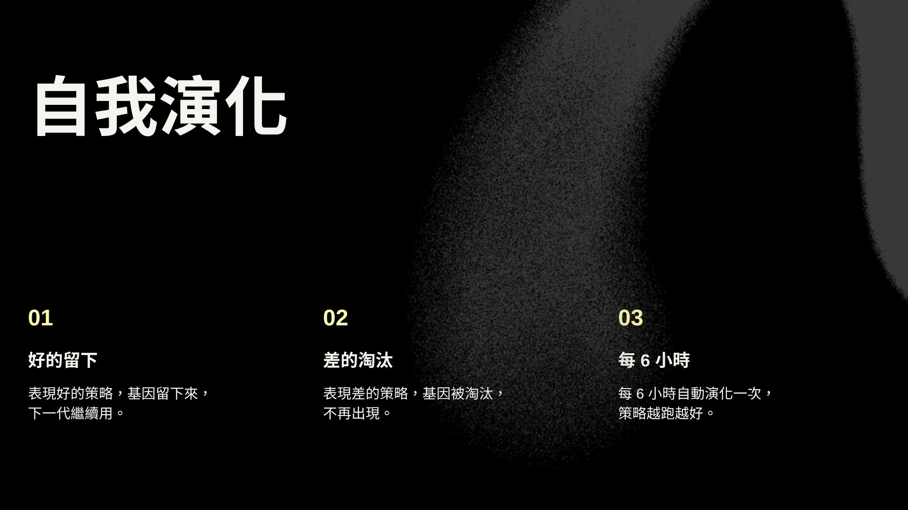

# TradeBot0 — ETH/USD Multi-Strategy Simulated Trading System

TradeBot0 is a locally run ETH/USD multi-strategy simulated trading app. It runs 5 quantitative strategies in parallel, each with $100,000 in virtual funds ($500,000 total), matching virtual orders against live market quotes and automatically tuning strategy parameters over time. Its built-in AI reads the news and judges market direction, filtering out trading signals that go against the trend.

> This app is a simulation tool. It does not connect to any real exchange account and never executes real-money trades.

---

## What Is It

TradeBot0 is a simulated trading app for ETH/USD. Five quantitative strategies compete side by side in one arena, each trading with $100,000 in virtual funds ($500,000 total) against live market prices. Orders are matched virtually, so every trade feels real — except no real money is ever at stake.

No real money, no fear of losses. It is made for anyone who wants to learn trading or try out strategies without risking a cent.

---

## Three Pain Points

Most people run into the same three problems when they start trading:

1. **Trading on gut feeling** — decisions made on impulse, without a system, easily turn into losses.
2. **No idea which strategy is best** — there are countless strategies out there, and no easy way to compare them fairly.
3. **Watching charts alone is exhausting** — staring at the screen all day, afraid to miss a move.

TradeBot0 is built to answer all three. Every trade follows a written, testable rule instead of a hunch. Five different strategies run side by side on the same market and the same capital, so you can see clearly which one actually performs. And the whole thing runs on its own, around the clock — you don't have to watch it.

---

## How It Works

Everything runs on virtual funds — no real money, so wins and losses are just practice. Three things make it work:

- **Five strategies compete head-to-head.** Aggressive, conservative, trailing, breakout, and mean reversion run together on the same market, so the best approach proves itself in the open.
- **Self-evolution gets better over time.** Strong strategies pass on their parameters to the next generation; weak ones are weeded out. The system keeps tuning itself while it runs.
- **AI intelligence reads the direction.** The built-in AI reads market news every day, judges the big direction, and only lets the strategies trade with the trend.

---

## Five Strategies

The system runs 5 independent strategy accounts in parallel, each starting with $100,000 in virtual funds:

| Strategy | Leverage | Logic & Risk Parameters |
| :--- | :---: | :--- |
| Aggressive Momentum | 3x | Trend-following momentum strategy. Allocates 70% per trade, 3.5% fixed stop-loss, no fixed take-profit, dynamic trailing stop. |
| Conservative Scalper | 1x (spot) | RSI mean-reversion scalping strategy. Allocates 25% per trade, 1.0% fixed stop-loss, 1.8% fixed take-profit. |
| Trailing Profit Guard | 2x | Trend-following strategy. Allocates 40% per trade, 1.5% fixed stop-loss; once profit reaches +1.0%, break-even protection kicks in, then the stop moves up in steps with price extremes. |
| ORB Breakout | 2.5x | 15-minute opening-range breakout strategy. Stop-loss at the range midpoint, target 2.0R, range resets daily at 00:00 UTC. |
| Session Mean Pullback | 1x (spot) | Range typical-price mean-reversion strategy, using the typical price as its reference, target 2.2R. |

The leaderboard ranks accounts by total equity (equity = cash + margin + unrealized P&L). Sharpe ratio, Sortino ratio, and maximum drawdown are used to score strategies when evolution tunes their parameters.

---

## Four Entry Filters

Before a trade signal reaches the matching engine, it passes through four filters in order. A signal has to clear all of them before any order is placed:

1. **Chop filter**: Reads the efficiency ratio on the 15-minute chart and blocks new entries while the market is choppy (exits are never blocked).
2. **Trend confirmation**: Compares the moving-average alignment on the 1-hour chart to make sure short-term signals follow the medium-to-long-term trend.
3. **Macro direction filter**: The AI assesses macro information and vetoes any strategy signal that conflicts with its direction.
4. **Win-rate check**: Simulates many possible price paths from historical returns to judge whether the trade is worth taking and how likely it is to hit the stop-loss or take-profit.

---

## How Capital Is Split

Each strategy gets its own account and its own slice of the virtual funds, with a cap on how much of its account it can put into a single trade:

- Aggressive Momentum: up to 70% per trade, chasing high returns.
- Conservative Scalper: up to 25% per trade, steady and safe.
- Trailing Profit Guard: up to 40% per trade.
- ORB Breakout: up to 45% per trade.
- Session Mean Pullback: up to 50% per trade.

Because the money is split across five independent accounts, one loss never wipes out everything. A bad day for one strategy leaves the other four untouched.

---

## AI Intelligence Hub

TradeBot0's built-in AI reads market news and judges market direction for you:

- **News summaries**: Collects market news from multiple public sources and condenses it into concise Traditional Chinese summaries.
- **Market direction**: Analyzes news and market events to judge whether the market favors going long, going short, or staying out. Entry signals that disagree with the AI's direction are blocked outright, and position sizes are adjusted to current conditions.
- **Intelligence Hub**: A live intelligence stream. Open any item to read the AI's in-depth analysis. Intelligence updates automatically every day — open the app and it's there, no need to hunt for news yourself.

**It works without an API key too.** The API key you enter is stored locally only — never uploaded, never written into the project files. Without an API key, the AI intelligence features go on standby and trading continues as usual, driven by technical indicators and risk rules.

---

## Self-Evolution

The strategies don't stay fixed — they evolve while the app runs:

- **Keep the good**: Strategies that perform well keep their parameters for the next generation.
- **Drop the bad**: Poor performers have their parameters crossed over and mutated, so their losing settings disappear for good.
- **Every 6 hours**: Evolution runs after every 6 hours of operation or 30 closed trades (with a 30-minute cooldown). Aggressive Momentum and Trailing Profit Guard keep their no-fixed-take-profit design.

Over time, the arena keeps the approaches that actually work and discards the ones that don't — so the system gets better the longer it runs.

---

## Three Steps to Start

Download, fill in, start — three steps and you're running:

1. **Download & Install** — Get the installer from GitHub and run it.
2. **Enter Your API Key** — Connect a free AI service by entering your Google Gemini API key in the setup wizard.
3. **Press Start** — Click test and launch, and the five strategies start trading.

---

Five strategies, AI intelligence, and self-evolution — all waiting for you in TradeBot0. Download the installer and start now.

---

## Versions

### Windows Desktop

Available now, for Windows 10 / Windows 11 (64-bit). Download the installer, install it, and enter your Google Gemini API key to start.

Source code and development: [TradeBot0-For-Windows](https://github.com/will095614/TradeBot0/tree/TradeBot0-For-Windows) .

### Android

In development, not released yet. A download will be provided here once it is ready.

Development: [TradeBot0-For-Android](https://github.com/will095614/TradeBot0/tree/TradeBot0-For-Android) .

---

## Download

### Windows

1. Download [TradeBot0Setup-V3.2.0.exe](https://github.com/will095614/TradeBot0/releases/download/v3.2.0/TradeBot0Setup-V3.2.0.exe) and run the installer.
2. The installer is not commercially code-signed, so Windows SmartScreen may show a prompt. Click "More info" and choose "Run anyway" to continue.
3. On first launch, a setup wizard appears: enter your Google Gemini API key, click test and launch, and you are ready to go.

### Android

Coming soon. The download link will be added here once the Android version is released.
