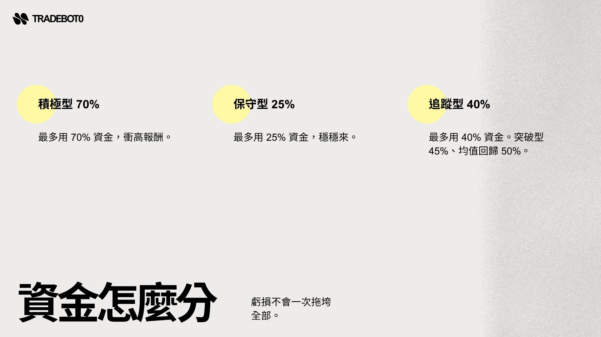
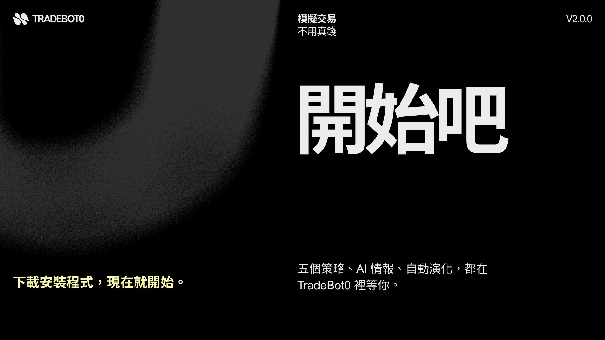

# TradeBot0 — ETH/USD 多策略模擬交易系統


TradeBot0 是一套在本機運行的 ETH/USD 多策略模擬交易軟體。系統同時運行 5 個量化策略，各配置 $100,000 虛擬資金（合計 $500,000），依據即時市場報價進行虛擬撮合，並定期自動調整策略參數。內建的 AI 會閱讀新聞、判斷市場方向，幫你過濾掉逆勢的交易訊號。

> 本軟體為模擬測試工具，不連接真實交易所帳戶，亦不執行任何真實資金交易。

---

## 專案介紹







---

## 快速開始

### 1. 使用安裝程式（一般使用者）

1. 下載 [TradeBot0Setup-V2.4.0.exe](https://github.com/will095614/TradeBot0/releases/download/v2.4.0/TradeBot0Setup-V2.4.0.exe) 並執行安裝。
2. 因安裝檔未包含商業數位簽章，Windows SmartScreen 可能顯示提示視窗，點擊「其他資訊」並選擇「仍要執行」即可繼續。
3. 首次啟動將顯示設定精靈：
   - 設定本機管理密碼。
   - 輸入 Google Gemini 的 API Key。精靈會自動安裝並啟動所需的 AI 服務。

### 2. 原始碼執行（開發者）

```powershell
# 啟動應用程式
.\.venv\Scripts\python.exe main.py

# 執行本機自我測試（驗證核心模組與 JSON 序列化，成功輸出 SELF_TEST_OK）
.\.venv\Scripts\python.exe main.py --self-test

# 執行單元與回歸測試套件
.\.venv\Scripts\python.exe -m pytest -q tests

# 打包執行檔（透過 PyInstaller 打包，再使用 Inno Setup 編譯 TradeBot0.iss）
powershell -ExecutionPolicy Bypass -File build_exe.ps1
```

---

## AI 情報功能

TradeBot0 內建的 AI 會幫你閱讀市場新聞、判斷市場方向。

### 功能職責

- **新聞摘要**：從多個公開來源收集市場新聞，整理成中文摘要。
- **市場方向判斷**：分析新聞與市場事件，判斷現在適合做多、做空還是觀望；方向不合的開倉訊號會直接被擋下來，也會依市況調整倉位大小。
- **情報中心**：即時情報流，點開一則情報就能看到 AI 寫的深度分析。

### 沒有 API Key 也能用

- **金鑰只存在你的電腦上**：你輸入的 API Key 只保存在本機，不會上傳，也不會寫進專案檔案。
- **AI 待機時照常交易**：沒有設定 API Key 時，AI 情報功能會待機，交易改由技術指標與風控邏輯照常進行。

---

## 五大策略規格

系統平行運作 5 個獨立策略帳戶，初始資金各為 $100,000 虛擬美元：

| 策略名稱 | 槓桿倍數 | 交易邏輯與風控參數 |
| :--- | :---: | :--- |
| Aggressive Momentum | 3x | 順勢追價策略。單筆配置 70% 倉位，3.5% 固定停損，無固定止盈，採動態追蹤停損。 |
| Conservative Scalper | 1x（現貨） | RSI 均值回歸短線策略。單筆配置 25% 倉位，1.0% 固定停損，1.8% 固定止盈。 |
| Trailing Profit Guard | 2x | 趨勢追蹤策略。單筆配置 40% 倉位，1.5% 固定停損；獲利達 +1.0% 啟動保本，後續依價格極值階梯式移動停利。 |
| ORB Breakout | 2.5x | 15 分鐘開盤區間突破策略。以區間中點為停損，目標獲利率 2.0R，每日 UTC 00:00 重置區間。 |
| Session Mean Pullback | 1x（現貨） | 區間典型價均值拉回策略。以典型均價為基準，目標獲利率 2.2R。 |

排行榜以帳戶總淨值排名（淨值 = 現金 + 保證金 + 未實現損益）；夏普值、索提諾值與最大回撤則用於演化調整參數時的評分。

---

## 風險控制與參數演化

### 1. 進場過濾機制

交易訊號在送交撮合引擎前，依序通過以下過濾：

1. **盤整過濾**：看 15 分鐘線的走勢效率，市場盤整時不開新倉（平倉不受影響）。
2. **趨勢確認**：比對 1 小時線均線排列，確保短線訊號順應中長線趨勢。
3. **宏觀方向過濾**：由 AI 評估宏觀資訊，策略訊號與 AI 判定的方向衝突時直接否決。
4. **勝率驗證**：用歷史報酬模擬大量可能的走勢，評估這筆交易划不划算、以及碰到停損或止盈的機率。

### 2. 參數演化機制

- **觸發條件**：系統每運行 6 小時或累積 30 筆平倉紀錄後執行一次參數演化（設有 30 分鐘冷卻時間）。
- **淘汰與變異**：依綜合表現排序，保留前 2 名策略的參數；對後 3 名策略進行參數交叉與變異微調。其中積極動量與移動停利策略維持不設固定止盈的特性。

### 3. 撮合與行情保護

- **滑價模擬**：撮合時依市場深度與波動計算滑價，模擬真實成交的衝擊。
- **連線中斷防護**：市場報價連線中斷時，系統停止新增開倉委託，介面會顯示連線狀態警告，不會用過期的價格下單。

---

## 專案結構

- `main.py`：主程式進入點，支援桌面 UI 介面、`--cli` 回測模式及 `--self-test` 自我測試。
- `src/arena/`：模擬撮合核心，包含虛擬券商 `BrokerSim`、資產記帳 `Portfolio`、風控模組 `RiskGuard`、排行榜 `Leaderboard` 與遺傳演算法 `GeneticEvolver`。
- `src/competitors/`：5 個量化策略實作與策略參數結構 `CompetitorGenome`。
- `src/data/`：行情與資料處理模組，包含主調度引擎 `live_engine.py`、報價來源 `quote_feeds.py`、技術指標運算 `indicator_engine.py`、策略執行器 `live_strategy_runner.py`、會話存檔 `session_codec.py`、WebSocket 行情串流 `ws_feed.py` 與歷史回測 `timemachine.py`。
- `src/intelligence/`：外部資訊整合模組，包含 OmniRoute 本機客戶端 `OmniRouteClient`、新聞採集 `IntelligenceHarvester`、宏觀方向決策 `MacroCommander` 與背景行程監控 `GatewaySupervisor`。
- `src/gui/`：使用者介面，包含桌面視窗控制器 `dashboard.py`、視圖資料 `view_model.py` 及前端頁面 `assets/`（`index.html`、`app.css`、`app.js`）。
- `tests/`：單元測試、回歸測試、合約測試與效能驗證套件。

---

## 系統需求與環境

- **作業系統**：Windows 10 / Windows 11（64 位元）。
- **Python 環境**（原始碼執行）：Python 3.10+，相關相依套件請參閱 `requirements.txt`。
- **AI 服務元件**：首次啟動時，設定精靈會自動安裝所需的 AI 服務元件，無須手動設定。

---

## 下載

[TradeBot0Setup-V2.4.0.exe](https://github.com/will095614/TradeBot0/releases/download/v2.4.0/TradeBot0Setup-V2.4.0.exe)（GitHub Release 單一載點）。
